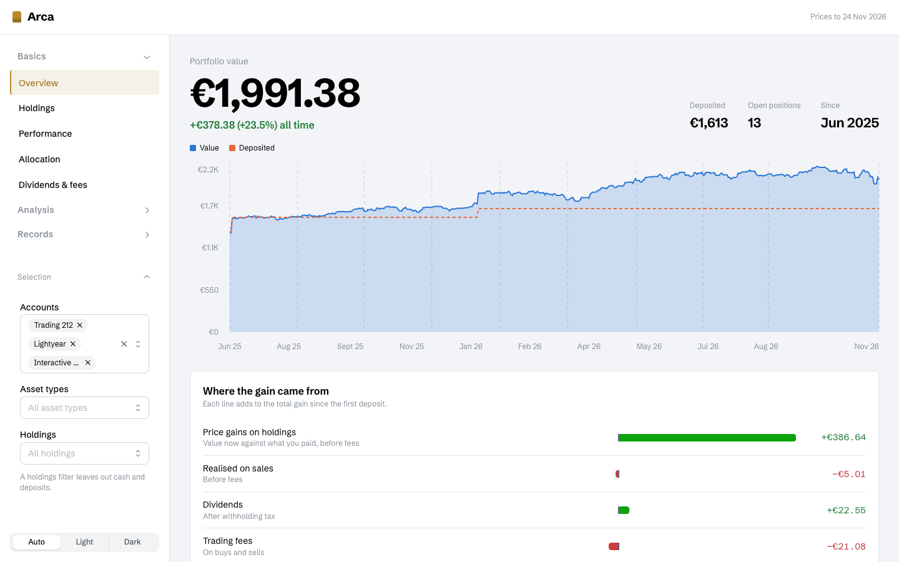
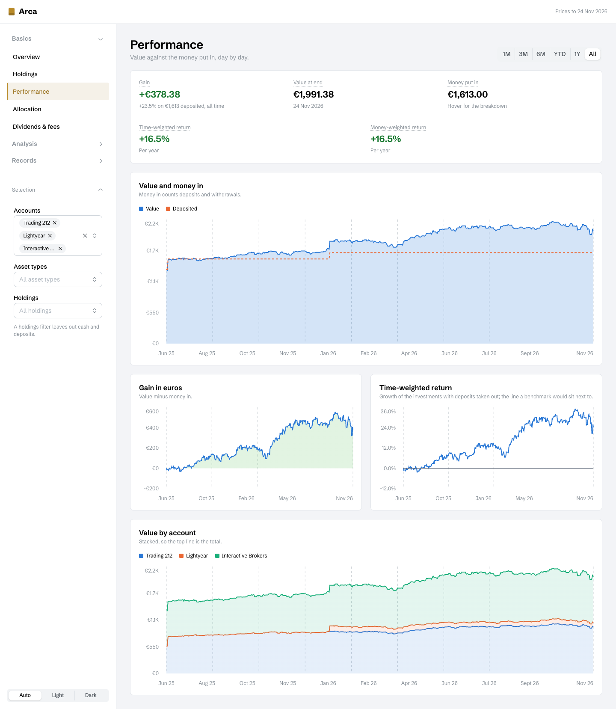
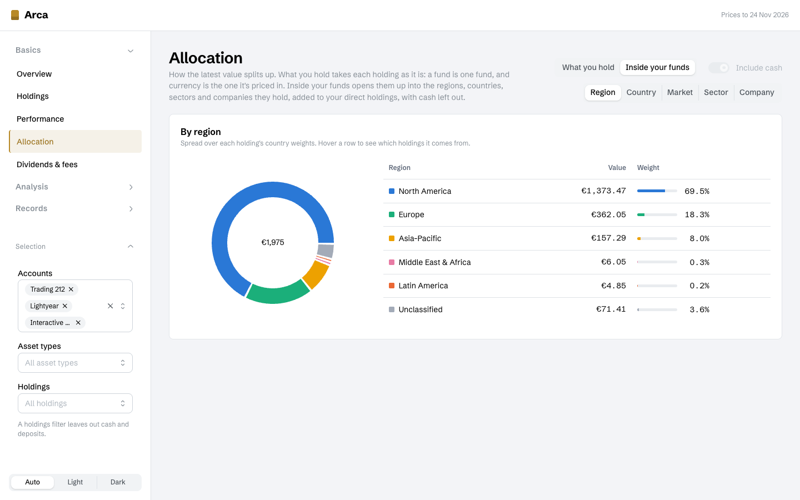
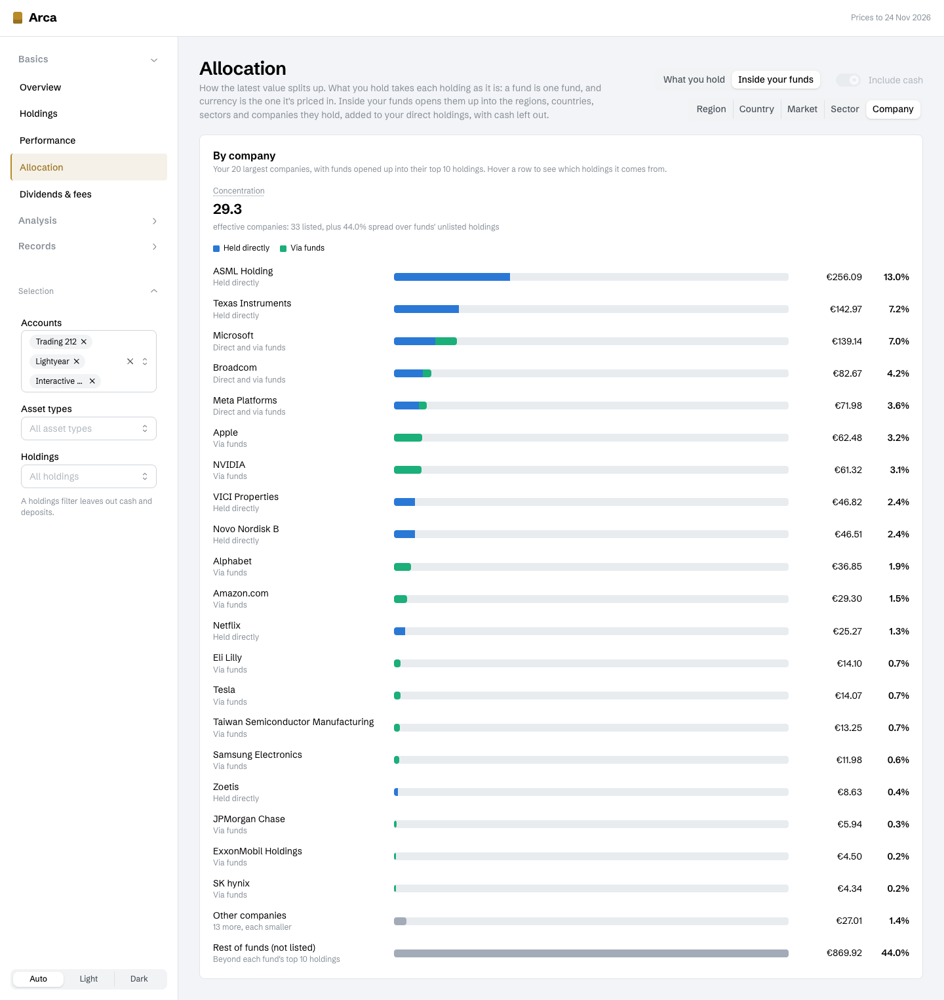
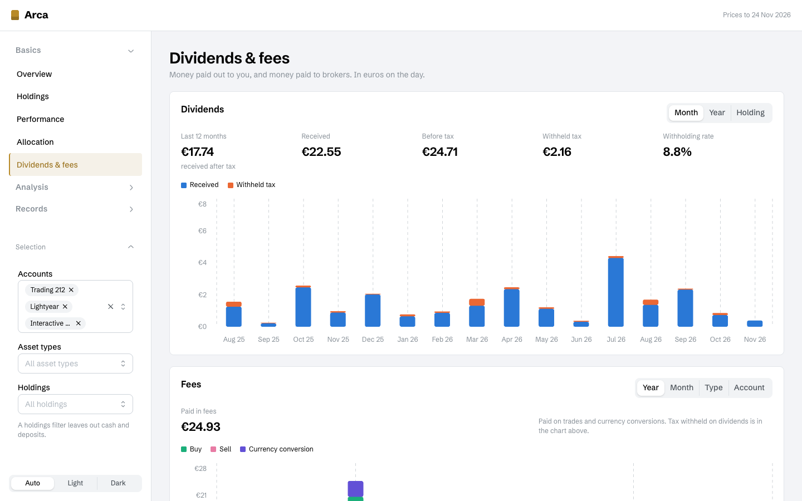
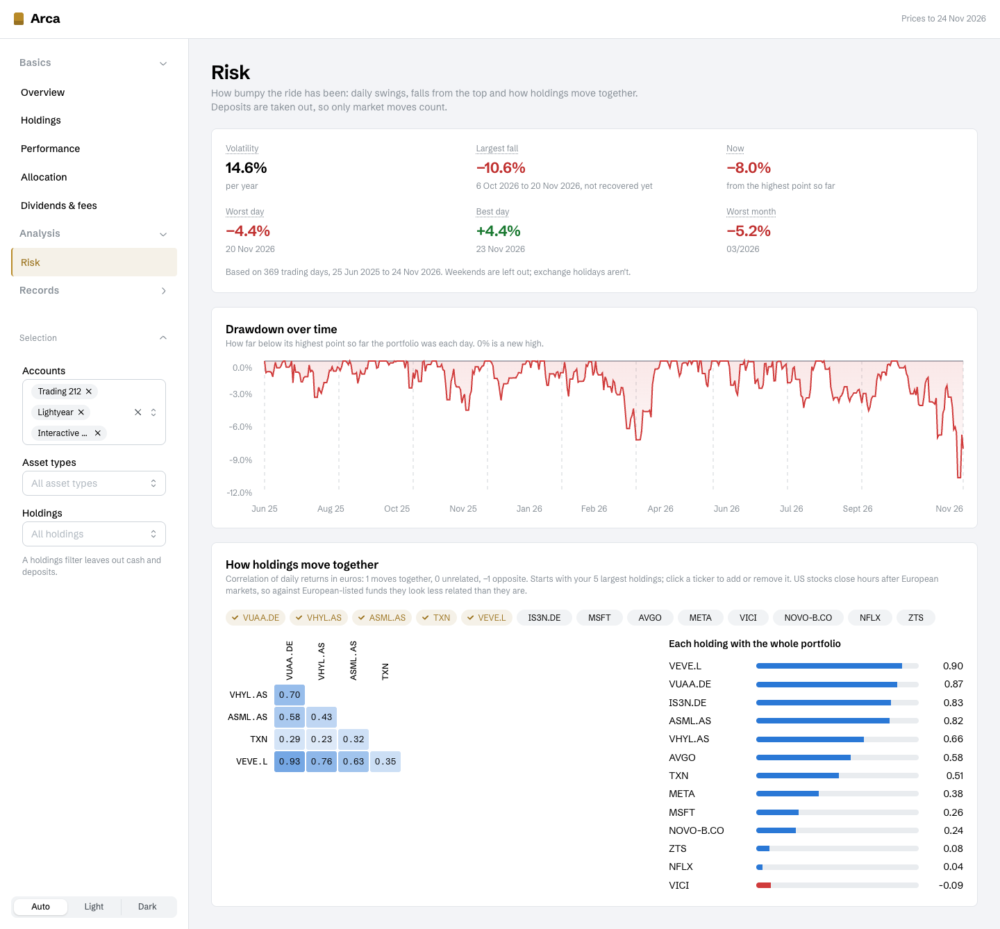

# Arca

A multi-broker portfolio tracker and analytics platform built on a transaction ledger.

> **Built for my own use.** Arca is shaped around my accounts and how I invest, not
> designed as a general tool. It handles the brokers, transaction types and currencies
> that appear in my own history, and some things are manual, hardcoded or not built
> yet because that's enough for what I need. If you want to use it yourself, expect
> to adapt it. See [Limitations](#limitations) for the details.

## Why I built this

My investments are spread across several brokerage apps. Each app shows its own
slice, but none of them shows the whole picture.

That makes simple questions hard to answer:

- What do I own in total, and how is it split by asset, region and currency?
- Which companies am I really invested in, once my ETFs are opened up?
- How much have I earned in dividends, and how much was withheld in tax?
- How well have my investments done, and how bumpy was the ride?

Arca brings every account into one database so I can answer these myself. It's also
a place to learn: I'm writing the code by hand and documenting each week's progress.

## What it looks like

A local dashboard reads the database. The sidebar picks the accounts, asset types and
holdings, and every page follows that selection. Everyday pages sit under Basics; the
deeper numbers are folded away under Analysis.

The overview shows the total across all three brokers against what I deposited, and
breaks the gain down into price gains, realised sales, dividends and fees.



Performance shows value and gain over a chosen range, and two return figures that
don't depend on when I deposited. The time-weighted return is how the investments
themselves did, the number fund factsheets and indexes report, so it can be compared
with them. The money-weighted return (XIRR) is what my euros actually earned, given
when they went in. Hovering any number explains it.



Allocation splits the latest value two ways. *What you hold* takes each holding as it
is, by asset type, currency, account or holding. *Inside your funds* opens the funds
up into the regions, countries, sectors and companies they hold, so a world ETF counts
towards North America, Europe and Asia-Pacific instead of showing up as one block.



The company view adds it all up: Microsoft held directly and inside two ETFs becomes
one row, split into what I hold directly and what comes through funds. A concentration
score turns each view into one number, such as "behaves like 1.9 equal countries",
and the part of each fund beyond its top 10 holdings stays visible instead of being
spread over the rest.



Dividends & fees shows what I received each month, what was withheld in tax, and
what I paid the brokers.



Risk shows how bumpy the ride has been, with deposits taken out so only market moves
count: volatility, the largest fall from a high and whether it has recovered, the
worst day and month, and a drawdown chart. Below it, a small correlation triangle
shows which holdings move together; clicking a ticker adds or removes it.



## How it works

Every app exports its history in a different format. Arca converts each export into
one shared ledger:

- A **transaction** is one event, such as a buy, deposit, dividend or currency
  conversion.
- Each transaction has one or more **legs**, where each leg is one movement of cash
  or shares. A buy has a shares leg, a cost leg and sometimes a fee leg.

Holdings and cash balances are calculated from the legs rather than stored, so there
is a single source of truth. Each importer is checked against the app's own balances.

Market data is added on top of the ledger: daily exchange rates from the European
Central Bank and daily prices from Yahoo Finance, so every position can be valued
in euros on every day. Fund sectors and top holdings also come from Yahoo Finance;
fund country weights come from the factsheets.

```text
broker exports ──► importers/ ──► transactions + legs ─┐
                                                       ├──► DuckDB ──► views
exchange rates, prices ──► market_data/ ───────────────┘
```

## Status

| Part                          | Status      |
|-------------------------------|-------------|
| Trading 212 importer          | Done        |
| Lightyear importer            | Done        |
| IBKR importer                 | Done        |
| Exchange rates (ECB)          | Done        |
| Daily prices (Yahoo Finance)  | Done        |
| Valuation over time           | Done        |
| Analysis functions            | Done        |
| Dashboard                     | Done        |
| Time- and money-weighted returns | Done     |
| Country, sector and company look-through | Done |
| Concentration score           | Done        |
| Risk: volatility, drawdowns, correlation | Done |
| Benchmark comparison          | Planned     |
| Data science                  | Planned     |

## Project structure

```text
db_files/           schema and views, applied in name order by init_db.py
importers/          one importer per broker, plus shared helpers in common.py
market_data/        exchange rates (fx.py), prices (prices.py), fund weights and holdings (exposures.py)
analysis/           portfolio calculations on a selection of accounts
dashboard/          the Dash app, with one file per page in dashboard/pages/
reference/          examples of the private reference files, and countries.csv (regions, market type)
tests/              tests and made-up sample exports in tests/fixtures/
docs/decisions.md   design decisions and why I made them
docs/screenshots/   the images in this README
init_db.py          creates the database
run_imports.py      runs every importer
update_all.py       runs the importers, then updates exchange rates, prices and fund weights
start.py            update_all.py, then opens the dashboard
data/               your exports, reference files and database (not in Git)
```

## Setup

Requires Python 3 (developed on 3.14).

    python -m venv .arca_env
    source .arca_env/bin/activate
    pip install -r requirements.txt

Then create your instrument reference file from the example:

    mkdir -p data/reference
    cp reference/instruments.example.csv data/reference/instruments.csv

It maps each security's ISIN to its name, type and Yahoo Finance ticker. Add one row
for every security you have ever held. The exports don't always say which exchange
a security trades on, so this mapping is done by hand.

Two more reference files are optional, with examples in `reference/`:

| File                                | What it's for                                                         |
|-------------------------------------|-----------------------------------------------------------------------|
| `data/reference/exposures.csv`      | Country weights of each fund from its factsheet, with the factsheet date. Refresh once a year; the Data page flags old or missing ones |
| `data/reference/companies.csv`      | Display names for company tickers, to merge share classes or fix a name |

## Usage

Run everything from the project folder.

### Add your exports

Export your history as CSV from each app and put the files in the broker's folder.
Exports often cover up to one year, so you may need several files.

| Broker      | Export                                            | Folder                                            |
|-------------|---------------------------------------------------|---------------------------------------------------|
| Trading 212 | History → Export (CSV)                            | `data/raw/trading212/`                            |
| Lightyear   | Account statement (CSV)                           | `data/raw/lightyear/`                             |
| IBKR        | Two Flex Queries: Trades, Cash Transactions (CSV) | `data/raw/ibkr/trades/` and `data/raw/ibkr/cash/` |

### Update everything

    python update_all.py

This imports any brokers whose files or importer code changed, then updates
exchange rates, prices, fund sector weights and fund top holdings up to today. It
creates the database if needed.

| Option      | What it does                                                         |
|-------------|----------------------------------------------------------------------|
| `--offline` | Rebuild exchange rates, prices and fund weights from the cache, no download |
| `--force`   | Re-import every broker, changed or not                               |

### Open the dashboard

    python -m dashboard.app

Or run `python start.py` to update everything first (same `--offline` and `--force`
options as `update_all.py`), then open the dashboard.

Then open http://127.0.0.1:8050. It opens the database read-only, and only while a
page loads, so `update_all.py` can run while it's open. If a page loads in the middle
of an update, it says the database is busy; reload it when the update has finished.

| Group    | Page             | What it shows                                                       |
|----------|------------------|---------------------------------------------------------------------|
| Basics   | Overview         | Total value, value against deposits, and where the gain came from   |
| Basics   | Holdings         | Open positions at average cost, each one's share of the gain, and gains realised on sales |
| Basics   | Performance      | Value and gain over a chosen range, time- and money-weighted returns, and value per account |
| Basics   | Allocation       | The latest value by what you hold (asset type, currency, account, holding) or inside your funds (region, country, market, sector, company), with a concentration score |
| Basics   | Dividends & fees | Dividends before and after tax, the last 12 months, and fees, by month, year and more |
| Analysis | Risk             | Volatility, drawdowns, worst and best day and month, and correlation between holdings |
| Records  | Activity         | Every transaction, searchable, with the cash it moved               |
| Records  | Data             | Last imports, how old each price and exchange rate is, and how old and complete each fund's country weights are |

The sidebar picks which accounts, asset types and holdings every page uses, and its
groups fold away. To add a page, add a file to `dashboard/pages/` that calls
`dash.register_page` with a `group`; it appears in the sidebar by itself.

### Run one step on its own

| Step           | Command                         | Notes                                              |
|----------------|---------------------------------|----------------------------------------------------|
| Imports        | `python run_imports.py`         | `--watch` keeps running and imports new files      |
| One importer   | `python -m importers.trading212` | Also `importers.lightyear` and `importers.ibkr`   |
| Exchange rates | `python -m market_data.fx`      | ECB rates from [Frankfurter](https://frankfurter.dev) |
| Prices         | `python -m market_data.prices`  | Applies the reference file first                   |
| Fund weights   | `python -m market_data.exposures` | Sectors and top holdings from Yahoo Finance, countries from `exposures.csv` |

Each import rebuilds that broker's data from all its files, so overlapping exports
don't create duplicates. Importers and market data scripts run as modules (`-m`) so
they can share code.

The prices script warns if Yahoo's price on your first buy date is far from what you
actually paid, which usually means a wrong ticker or a price quoted in pence. Both
market data scripts cache what they download in `data/raw/` and accept `--offline`.

## What's in the database

The database is `data/arca.duckdb`. These views can be queried like tables, and every
one keeps `account_id`, so any combination of accounts can be selected.

| View                          | What it gives                                                        |
|-------------------------------|----------------------------------------------------------------------|
| `holdings`, `cash_balances`   | Current shares and cash per account                                  |
| `daily_holdings`, `daily_cash` | Shares and cash per account on every day                            |
| `daily_prices`, `daily_fx`    | The latest price and EUR exchange rate on every day                  |
| `daily_valuation`             | The value in EUR of every position and cash balance, per account and day |
| `holding_changes`             | Every buy, sell and reinvestment, with its value                     |
| `transaction_summary`         | One row per transaction                                              |

Next to the views, `exposures` holds each instrument's country, sector and company
weights, and `companies` gives each company ticker one display name.

Markets and the ECB don't publish every day, so weekends and holidays use the latest
available price and rate. `price_date` and `rate_date` show which day they come
from, so values are never mistaken for live ones.

For example, the total value of all accounts over time:

```sql
SELECT date, SUM(value_eur) AS value_eur
FROM daily_valuation
GROUP BY date
ORDER BY date;
```

## Tests

    pytest

The tests use small made-up exports in `tests/fixtures/` and never call an API.

## Privacy

Real exports, the reference file and the database all live in `data/`, which is
excluded from Git. No personal financial data is committed, and the tests use
made-up sample files.

## Limitations

Arca does what I need it to do. Some things are deliberately simple:

- **Manual exports:** Importing starts from CSV files you download yourself. None of
  the broker APIs are used.
- **Only what I've seen:** Each importer handles the transaction types in my own
  history. Anything else, such as an IBKR sell or a Trading 212 dividend with
  withholding tax, stops the import with an error rather than guessing.
- **Hardcoded accounts:** Each broker is one account with a fixed ID, and the base
  currency is EUR.
- **Asset types:** Trading 212 and Lightyear exports don't include them, so they come
  from the reference file.
- **Lightyear deposit fees** are not recorded.
- **Prices come from Yahoo Finance** through the unofficial `yfinance` library,
  which can break if Yahoo changes something. The cached files keep earlier
  downloads usable.
- **Daily closing prices only:** Values are as of the last close, not live.
- **Fund look-through is approximate:** Companies come from each fund's top 10
  holdings only, and the rest is shown as its own row. Fund country weights are typed
  in from factsheets once a year.
- **Risk uses daily closes:** Weekends are left out but exchange holidays aren't.
  US stocks close hours after European markets, so their correlation with
  European-listed funds reads lower than it really is.

## Documentation

- [`docs/decisions.md`](docs/decisions.md): Design decisions and why I made them

## Disclaimer

This is a personal project, not financial advice. The numbers are only as accurate
as the exports and market data behind them.

## License

MIT
